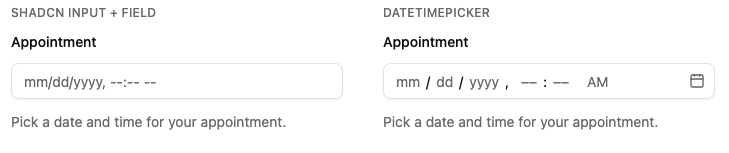
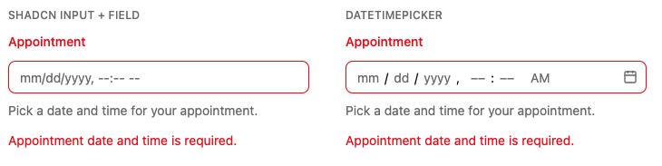

# DateTime Picker

A date and time picker for [shadcn/ui](https://ui.shadcn.com), built on [React Aria Components](https://react-spectrum.adobe.com/react-aria/DatePicker.html). Combines calendar selection with scrollable hour/minute/second/AM-PM columns, supports 12/24-hour formats, and lets you dial in exactly how much granularity you need — day only, or down to the second.

## Preview

Designed to sit alongside shadcn's `Input` and `Field` components with matching layout, spacing, and states.





## Installation

```bash
npx shadcn@latest add https://raw.githubusercontent.com/mrphilipp7/shadcn-datetime-picker/main/public/r/datetime-picker.json
```

This installs `datetime-picker.tsx` and `datetime-picker-context.ts` into `components/datetime-picker/` (or `src/components/datetime-picker/` if your project uses a `src` directory), plus the `button` and `scroll-area` shadcn components and the `@internationalized/date`, `react-aria-components`, and `lucide-react` dependencies it relies on.

## Usage

```tsx
import { useState } from "react"
import { type DateValue } from "react-aria-components"

import { DateTimePicker } from "@/components/datetime-picker/datetime-picker"

export function Example() {
  const [value, setValue] = useState<DateValue | null>(null)

  return (
    <DateTimePicker
      label="Appointment"
      value={value}
      onChange={setValue}
      pickerProps={{
        hourCycle: 24,
      }}
    />
  )
}
```

### `DatePicker` vs `DateTimePicker`

- `DatePicker` — calendar only, day granularity.
- `DateTimePicker` — calendar plus time columns, minute granularity by default.

Both share the same props and render the same underlying component; `DatePicker` just pins `pickerProps.granularity` to `"day"`.

### With `Field`

The picker works like shadcn's `Input` inside a [`Field`](https://ui.shadcn.com/docs/components/field). Give it an `id` and point `FieldLabel` at it with `htmlFor`. Skip the picker's own `label`, `description`, and `errorMessage` props; the `Field` components replace them.

```tsx
<Field data-invalid={isInvalid}>
  <FieldLabel htmlFor="appointment">Appointment</FieldLabel>
  <DateTimePicker
    id="appointment"
    value={value}
    onChange={setValue}
    aria-invalid={isInvalid}
  />
  <FieldDescription>Pick a date and time for your appointment.</FieldDescription>
  {isInvalid && <FieldError>Appointment date and time is required.</FieldError>}
</Field>
```

Clicking the `FieldLabel` focuses the picker, and screen readers announce the label as the picker's name.

### Props

| Prop           | Type                                 | Description |
| -------------- | ------------------------------------ | ----------- |
| `value`        | `DateValue \| null`                  | Controlled value ([`@internationalized/date`](https://react-spectrum.adobe.com/internationalized/date/index.html) type). |
| `onChange`     | `(value: DateValue \| null) => void` | Called on any date or time change. |
| `id`           | `string`                             | Pair with `<FieldLabel htmlFor>`. |
| `name`         | `string`                             | Submits the value as an ISO string with native forms. |
| `onBlur`       | `() => void`                         | Called when focus leaves the picker. Moving into the calendar popover doesn't count. |
| `onFocus`      | `() => void`                         | Called when focus enters the picker. |
| `aria-invalid` | `boolean`                            | Shows the invalid state. |
| `disabled`     | `boolean`                            | Disables the picker. |
| `autoFocus`    | `boolean`                            | Focuses the picker on mount. |
| `ref`          | `Ref<HTMLElement>`                   | Resolves to the first editable segment, so form libraries can focus the picker when validation fails. |
| `label`        | `string`                             | Built-in label. Use `FieldLabel` instead when composing with `Field`. |
| `description`  | `string`                             | Built-in helper text. |
| `errorMessage` | `string`                             | Built-in error text. |
| `className`    | `string`                             | Applied to the root. |
| `pickerProps`  | `PickerProps`                        | Passed through to the underlying React Aria `DatePicker`: `granularity`, `hourCycle`, `minValue`, `maxValue`, etc. |

`granularity` accepts `"day" | "hour" | "minute" | "second"` and controls which time columns render. `hourCycle` accepts `12 | 24`; the AM/PM column only shows up in 12-hour mode.

## Forms

The picker works with each form library on [shadcn's forms page](https://ui.shadcn.com/docs/forms), wired the same way as shadcn's `Input` examples. The value is a `DateValue`, so validate it with a custom schema type.

### React Hook Form

Spread `field` onto the picker. It supplies `name`, `value`, `onChange`, `onBlur`, `ref`, and `disabled`, so the picker is focused when validation fails.

```tsx
import { zodResolver } from "@hookform/resolvers/zod"
import { type DateValue } from "react-aria-components"
import { Controller, useForm } from "react-hook-form"
import * as z from "zod"

import { DateTimePicker } from "@/components/datetime-picker/datetime-picker"
import { Button } from "@/components/ui/button"
import {
  Field,
  FieldDescription,
  FieldError,
  FieldGroup,
  FieldLabel,
} from "@/components/ui/field"

const formSchema = z.object({
  appointment: z
    .custom<DateValue | null>()
    .refine((value) => value !== null, "Appointment date and time is required."),
})

export function AppointmentForm() {
  const form = useForm({
    resolver: zodResolver(formSchema),
    defaultValues: { appointment: null },
  })

  return (
    <form onSubmit={form.handleSubmit((data) => console.log(data.appointment))}>
      <FieldGroup>
        <Controller
          name="appointment"
          control={form.control}
          render={({ field, fieldState }) => (
            <Field data-invalid={fieldState.invalid}>
              <FieldLabel htmlFor="appointment">Appointment</FieldLabel>
              <DateTimePicker
                {...field}
                id="appointment"
                aria-invalid={fieldState.invalid}
              />
              <FieldDescription>
                Pick a date and time for your appointment.
              </FieldDescription>
              {fieldState.invalid && <FieldError errors={[fieldState.error]} />}
            </Field>
          )}
        />
      </FieldGroup>
      <Button type="submit">Submit</Button>
    </form>
  )
}
```

### TanStack Form

`field.handleChange` takes the value directly, so pass it straight to `onChange`.

```tsx
import { useForm } from "@tanstack/react-form"
import { type DateValue } from "react-aria-components"
import * as z from "zod"

// ...same component imports as above

const formSchema = z.object({
  appointment: z
    .custom<DateValue | null>()
    .refine((value) => value !== null, "Appointment date and time is required."),
})

export function AppointmentForm() {
  const form = useForm({
    defaultValues: { appointment: null as DateValue | null },
    validators: { onSubmit: formSchema },
    onSubmit: ({ value }) => console.log(value.appointment),
  })

  return (
    <form
      onSubmit={(e) => {
        e.preventDefault()
        form.handleSubmit()
      }}
    >
      <FieldGroup>
        <form.Field
          name="appointment"
          children={(field) => {
            const isInvalid =
              field.state.meta.isTouched && !field.state.meta.isValid
            return (
              <Field data-invalid={isInvalid}>
                <FieldLabel htmlFor="appointment">Appointment</FieldLabel>
                <DateTimePicker
                  id="appointment"
                  name={field.name}
                  value={field.state.value}
                  onBlur={field.handleBlur}
                  onChange={field.handleChange}
                  aria-invalid={isInvalid}
                />
                <FieldDescription>
                  Pick a date and time for your appointment.
                </FieldDescription>
                {isInvalid && <FieldError errors={field.state.meta.errors} />}
              </Field>
            )
          }}
        />
      </FieldGroup>
      <Button type="submit">Submit</Button>
    </form>
  )
}
```

### Formisch

Spread `field.props` for `name`, `ref`, `onFocus`, `onBlur`, and `autoFocus`, then override `onChange` with `field.onChange`, which takes the value directly. `field.input` starts out `undefined`, so default it to `null` to keep the picker controlled.

```tsx
import { Form, Field as FormischField, useForm } from "@formisch/react"
import { type DateValue } from "react-aria-components"
import * as v from "valibot"

// ...same component imports as above

const FormSchema = v.object({
  appointment: v.pipe(
    v.custom<DateValue | null>(() => true),
    v.check((value) => value !== null, "Appointment date and time is required.")
  ),
})

export function AppointmentForm() {
  const form = useForm({
    schema: FormSchema,
    initialInput: { appointment: null },
  })

  return (
    <Form of={form} onSubmit={(output) => console.log(output.appointment)}>
      <FieldGroup>
        <FormischField of={form} path={["appointment"]}>
          {(field) => (
            <Field data-invalid={field.errors !== null}>
              <FieldLabel htmlFor="appointment">Appointment</FieldLabel>
              <DateTimePicker
                {...field.props}
                id="appointment"
                value={field.input ?? null}
                onChange={field.onChange}
                aria-invalid={field.errors !== null}
              />
              <FieldDescription>
                Pick a date and time for your appointment.
              </FieldDescription>
              {field.errors && (
                <FieldError
                  errors={field.errors.map((message) => ({ message }))}
                />
              )}
            </Field>
          )}
        </FormischField>
      </FieldGroup>
      <Button type="submit">Submit</Button>
    </Form>
  )
}
```

## Development

The component source lives in `registry/datetime-picker/`. `components/ui/` and `lib/` are dev-only copies of the shadcn components and `cn` helper the component and examples depend on, so everything can render locally. They are not shipped.

```bash
npm install
npm run storybook        # http://localhost:6006
npm test                 # Vitest + Testing Library
```

Stories and tests live next to the component. `registry/datetime-picker/examples/` holds one form per supported library; the **DateTime Picker → Forms** stories render them, and `datetime-picker.test.tsx` drives them the way a user would (typing, picking from the popover, submitting, validation errors, focus on error). Only files listed in `registry.json` are published, so stories, tests, and examples never reach users.

### Maintaining this registry

`public/r/*.json` is generated output, not hand-written. It's what the `npx shadcn add` URL above actually serves, with the component source embedded as `content`. After changing anything in `registry/` or `registry.json`, regenerate it before committing:

```bash
npm run registry:build
```

Each file's `target` in `registry.json` controls where it installs in the user's project.

## License

[MIT](./LICENSE)
